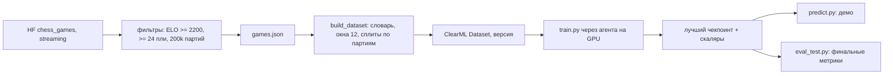

# Предсказание следующего шахматного хода (LSTM)

- Проект по дисциплине «Прикладные методы искусственного интеллекта».
- Выполнил: студент группы 4165 Скринник Игорь Николаевич.
- Репозиторий: https://github.com/puzinho/ML
- Датасет: https://huggingface.co/datasets/angeluriot/chess_games
- ClearML: проект `Chess_LSTM`, задача v7 и датасет `Chess UCI Dataset`
- Ссылка на видео: https://cloud.mail.ru/public/1a7E/AJHqYgipx
<video src="video.mp4" controls width="100%"></video>


---

Учебный проект: модель глубокого обучения, которая по истории партии предсказывает
следующий ход одной из сторон. Задача сформулирована как многоклассовая классификация:
вход — окно из последних 12 полуходов в нотации UCI, выход — распределение вероятностей
по словарю из 1901 возможного хода.

Проект включает полный воспроизводимый конвейер: сбор данных, версионирование датасета,
обучение на удалённом GPU через агента, трекинг экспериментов, финальную оценку на
независимом тесте и интерактивное демо предсказаний.

## Содержание

1. [Постановка задачи](#1-постановка-задачи)
2. [Данные](#2-данные)
3. [Модель](#3-модель)
4. [Обучение](#4-обучение)
5. [Инфраструктура и воспроизводимость](#5-инфраструктура-и-воспроизводимость)
6. [Результаты](#6-результаты)
7. [Структура репозитория](#7-структура-репозитория)
8. [Установка и запуск](#8-установка-и-запуск)
9. [Демо-сценарий](#9-демо-сценарий)
10. [Ограничения](#10-ограничения)

---

## 1. Постановка задачи

- **Вход:** последние 12 полуходов партии (полуход = ход одной стороны; 12 полуходов = 6 полных ходов).
- **Выход:** топ-5 наиболее вероятных следующих ходов с вероятностями; одиночный ответ модели — top-1.
- **Метрики:** cross-entropy loss, Top-1 / Top-3 / Top-5 accuracy (доля примеров, где настоящий
  ход попал в k наиболее вероятных предсказаний).
- **Бейзлайны для сравнения:** частотный (всегда самые популярные ходы корпуса) и
  марковский первого порядка (топ-5 ответов на последний ход контекста).

Задача выбрана как последовательностная: шахматная партия — это временной ряд токенов,
что делает её естественным полигоном для рекуррентных сетей.

---

## 2. Данные

### 2.1 Источник и отбор

- Источник: публичный датасет `angeluriot/chess_games` (HuggingFace), партии трансляций Lichess.
- Сбор выполнен потоковым режимом `datasets.load_dataset(..., streaming=True)`: скачивается
  только прочитанная часть файла, а не весь архив на 7 ГБ.
- Фильтры отбора:
  - рейтинг обоих игроков **≥ 2200 ЭЛО** (качество ходов: модель учится у сильных игроков);
  - длина партии **≥ 24 полуходов** (отсев мусорных и мгновенно сданных партий);
  - лимит **200 000 партий** (детерминированный срез: порядок стрима + фиксированные фильтры
    дают идентичный набор при повторном сборе).

### 2.2 Формат и статистика

- `games.json`: список строк, каждая строка — партия, ходы UCI через пробел (`e2e4 e7e5 g1f3 ...`).
- Рокировка кодируется как ход короля на два поля (`e1g1`, `e1c1`, `e8g8`, `e8c8`), ладья отдельно не токенизируется.
- Превращения пешки — пятибуквенные токены (`c7c8q`).
- Статистика: 200 000 партий; средняя длина ≈ 88 полуходов (медиана 81, максимум 600).

### 2.3 Нарезка примеров и размер окна

Скользящее окно: из партии длины L получается L − 12 примеров вида
`(ходы[i-12:i] → ход[i])`. Итого ≈ 15.2 млн примеров (шаг нарезки stride = 1).

**Почему окно именно 12 полуходов** (инженерный компромисс, зафиксирован в проекте):

- *Информативность:* окно накрывает фазу развития фигур и последние тактические события
  (взятия, шахи, рокировки), которые в наибольшей степени определяют следующий ход.
- *Стоимость:* обучение LSTM идёт обратным распространением сквозь время, вычисления и память
  растут линейно с длиной последовательности; окно 12 сохраняет время эпохи приемлемым
  на бесплатных GPU-квотах.
- *Архитектура:* эффективный горизонт памяти LSTM ограничен примерно 10–20 шагами, поэтому
  дальний конец более длинного окна использовался бы слабо без механизма внимания.
- *Статус значения:* 12 — базовое значение; проверка гипотезы о пользе окна 24 вынесена
  в дальнейшую работу и в рамках проекта не проводилась из-за ограничений вычислительных квот.

Скользящее окно позволяет подавать на вход историю любой длины: используются её последние 12 полуходов.

### 2.4 Словарь

- Токены — уникальные UCI-ходы с частотой ≥ 2 (`MIN_FREQ = 2`); более редкие ходы отображаются в `<UNK>`.
- Служебные токены: `<PAD> = 0` (дополнение короткой истории), `<UNK> = 1`.
- Итоговый размер словаря: **1901 токен**. Порядок индексов — порядок первого появления хода в партиях.
- Словарь сохраняется как `vocab.json` и версиируется вместе с датасетом: веса модели и словарь
  обязаны происходить из одной версии датасета (число классов модели равно размеру словаря).

### 2.5 Сплиты и воспроизводимость

- Разделение **по партиям**, а не по примерам: сначала партии перемешиваются генератором с
  фиксированным `SPLIT_SEED = 42`, затем делятся 80/10/10, и только потом нарезаются примеры.
  Это исключает утечку: перекрывающиеся окна одной партии не попадают одновременно в train и val/test.
- Примеры: train ≈ 12.16 млн, val ≈ 1.52 млн, test ≈ 1.52 млн (test = 1 519 997).
- Фиксированный seed делает сплиты идентичными между пересборками, поэтому метрики версий сравнимы.

### 2.6 Тензорное представление

- Тензор — многомерный массив чисел одного типа; базовый контейнер PyTorch. Используется потому,
  что операции векторизованы (CPU/GPU без питоновских циклов), поддерживают autograd и хранятся
  плотно в памяти, в отличие от списков питоновских объектов.
- `X`: [N, 12] int16 — индексы контекстов; `y`: [N] int16 — целевые индексы.
- **Почему int16:** индексы < 32767, поэтому 2 байта на элемент вместо 8 дают четырёхкратную
  экономию диска, трафика и RAM (файл датасета ≈ 400 МБ вместо ≈ 1.6 ГБ).
- **Почему `.long()` при подаче в модель:** `nn.Embedding` и `CrossEntropyLoss` требуют int64.
  Конвертация выполняется побатчево на устройстве, чтобы не создавать полноразмерную int64-копию в RAM.
- Артефакт `dataset.pt`: словарь из шести тензоров `X_train/y_train/X_val/y_val/X_test/y_test`.

---

## 3. Модель

Архитектура `ChessLSTM`:

| Слой | Параметры | Назначение |
|---|---|---|
| Embedding | 1901 × 128 | векторное представление хода |
| LSTM | 2 слоя × 256 hidden, dropout 0.2, batch_first | сжатие истории партии в вектор памяти |
| Linear | 256 → 1901 | логиты по словарю ходов |

- Всего параметров ≈ 1.65 млн.
- На вход подаётся окно индексов, на выходе — логиты; вероятности получаются softmax.
- **Почему LSTM:** задача последовательностная, порядок ходов несёт смысл; LSTM умеет хранить
  контекст переменной длины и обучается на порядки дешевле трансформера на наших объёмах.
- **Почему такие размеры:** ёмкость подбиралась по балансу «хватает выучить / не переобучается»;
  рост emb 64→128 и hidden 128→256 на ранних версиях дал прирост метрик, дальнейший рост
  на малых данных усиливал переобучение (см. раздел 6).

---

## 4. Обучение

| Параметр | Значение | Обоснование |
|---|---|---|
| batch_size | 64 | устойчивый градиент и плотная загрузка GPU |
| lr | 1e-3 | стандартная стартовая точка Adam |
| weight_decay | 1e-4 | победитель свипа регуляризации (L2-штраф против переобучения) |
| dropout | 0.2 | базовая регуляризация; 0.3 и комбинации в свипе не дали прироста |
| epochs | 30 (потолок) | фактическую остановку решает early stopping |
| patience | 3 | остановка при отсутствии рекорда val; прогон v7 остановился на эпохе 15 |
| optimizer | Adam | стандарт для последовательностных задач |
| loss | CrossEntropyLoss | многоклассовая классификация |

- Лучший чекпоинт выбирается по val loss и сохраняется как `models/chess_lstm_best.pth`.
- **Свип регуляризации:** weight_decay 1e-4 против нуля дал val 4.54 против 5.02 на раннем датасете;
  dropout 0.3 сам по себе — косметический прирост, в паре с weight_decay не лучше одиночного wd.
  Отрицательные результаты зафиксированы как часть экспериментальной работы.
- **Бейзлайны:** частотный Top-5 ≈ 3.7%; марковский первого порядка Top-5 ≈ 15%.
  Марковский считается векторизованно: упаковка пары (последний ход, ответ) в один индекс,
  `bincount` → матрица частот → `topk` по строкам → gather кандидатов → сравнение с целью.

---

## 5. Инфраструктура и воспроизводимость

- **GitHub** (`puzinho/ML`, папка `chess_lstm/`): единственный источник кода; агент клонирует
  репозиторий и фиксирует коммит задачи, поэтому каждый прогон воспроизводим по коду.
- **ClearML**: трекинг задач, скаляры (Loss, Accuracy, Baseline), таблицы, артефакты и веса моделей;
  версионирование датасета (`Chess UCI Dataset` в проекте `Chess_LSTM`). Каждая версия датасета
  хранит `dataset.pt` + `vocab.json`; обучающие задачи подтягивают последнюю Final-версию через `ensure_data()`.
- **clearml-agent**: демон на GPU (Colab T4), слушающий очередь; выполняет задачи из очереди
  в изолированном venv, сам ставит зависимости из requirements.
- **for_agent.py**: клонирует шаблон задачи, фиксирует конфигурацию и ставит её в очередь.
- **Гигиена теста:** все решения во время работы принимались по val; тестовый сплит прогнан
  один раз в конце (`eval_test.py`), его цифры не использовались для выбора модели.
- **Известные инфраструктурные ограничения:** бесплатные квоты Colab обрывают длинные сессии;
  финальная оценка и демо выполняются локально на CPU и не требуют GPU.

### Схема пайплайна



### Что логируется в ClearML

| Скрипт | Что отправляется в ClearML |
|---|---|
| `build_dataset.py` | версия датасета (dataset.pt, vocab.json), статистика сборки, таблицы сплитов и топ-ходов |
| `train.py` | скаляры Loss / Accuracy / Baseline, гиперпараметры, консоль, веса лучшего чекпоинта |
| `for_agent.py` | задача в очереди с зафиксированным коммитом и конфигурацией |
| `predict.py` / `eval_test.py` | локальные скрипты, в ClearML не логируют |

---

## 6. Результаты

### 6.1 История версий (val Top-5)

| Версия | Изменение | Top-5 (val) |
|---|---|---|
| частотный бейзлайн | — | ≈ 3.7% |
| марковский бейзлайн | — | ≈ 15% |
| v1 | первая LSTM | 26% |
| v2 | рост ёмкости (emb 128, hidden 256) | 28% |
| v5 | early stopping | 29.3% |
| v6 | weight_decay 1e-4 | 34.1% |
| v7 | большой датасет (200k партий, ≥2200 ЭЛО) | ≈ 34.5% |

### 6.2 Финальные метрики на независимом тесте (v7)

| Метрика | Значение |
|---|---|
| test examples | 1 519 997 |
| test loss | 4.4451 |
| test Top-1 | 0.1409 |
| test Top-3 | 0.2688 |
| test Top-5 | 0.3464 |

Интерпретация: равномерное угадывание по 1901 классу дало бы loss ln(1901) ≈ 7.55; наше 4.445
соответствует перплексии ≈ 85, то есть модель эффективно выбирает из ~85 правдоподобных ходов.
Top-5 34.6% превосходит марковский бейзлайн в ≈ 2.3 раза и частотный в ≈ 9 раз.
Совпадение test loss (4.4451) с val loss (4.4445) подтверждает отсутствие подстройки под val.

### 6.3 Диагноз по кривым обучения

На малом датасете наблюдалось переобучение (train loss значительно ниже val). На датасете
200k партий разрыв train/val исчез (val даже чуть ниже train за счёт dropout и усреднения
по эпохе): данные перестали быть лимитирующим фактором, потолок определяется вместимостью
модели и длиной окна контекста. Это обосновывает дорожную карту дальнейшей работы (раздел 11).

---

## 7. Структура репозитория

```
chess_lstm/
├── data/
│   ├── build_dataset.py     # сборка датасета: словарь, нарезка, сплиты, заливка в ClearML
│   ├── new_dataset.py       # Скачивание датасета с помощью streaming с HF
│   └── processed/           # games.json, vocab.json, dataset.pt (локальные копии)
├── data_loader.py           # ensure_data(): подтягивает датасет из ClearML при отсутствии файлов
├── train.py                 # обучение, early stopping, логирование в ClearML, чекпоинт
├── for_agent.py              # постановка обучающей задачи в очередь агента
├── predict.py               # интерактивное демо предсказаний
├── eval_test.py             # финальная оценка на тестовом сплите
├── models/
│   └── chess_lstm_best.pth  # веса лучшего чекпоинта v7
└── requirements.txt
```

---

## 8. Установка и запуск

### 8.1 Окружение

```powershell
python -m venv venv
.\venv\Scripts\Activate.ps1
pip install -r requirements.txt
```

Зависимости: `torch`, `clearml`, `datasets`, `pandas`, `tqdm`, `numpy`. Python ≥ 3.10.

### 8.2 Ключи ClearML

```powershell
clearml-init
```

либо переменные окружения `CLEARML_API_ACCESS_KEY` / `CLEARML_API_SECRET_KEY`.

### 8.3 Подготовка данных

Сбор сырья потоковым режимом (выполнялся в Colab; фильтры и лимит детерминированы):

```python
from datasets import load_dataset
import json
from pathlib import Path

ds = load_dataset("angeluriot/chess_games", split="train", streaming=True)
games = []
for game in ds:
    try:
        w = int(game["white_elo"]); b = int(game["black_elo"])
    except (KeyError, TypeError, ValueError):
        continue
    if w < 2200 or b < 2200:
        continue
    moves = game.get("moves_uci") or []
    if len(moves) < 24:
        continue
    games.append(" ".join(moves))
    if len(games) >= 200_000:
        break

out = Path("chess_lstm/data/processed")
out.mkdir(parents=True, exist_ok=True)
(out / "games.json").write_text(json.dumps(games, ensure_ascii=False), encoding="utf-8")
```

Сборка датасета и заливка версии в ClearML:

```powershell
python chess_lstm/data/build_dataset.py
```


### 8.4 Обучение

Через агента (рекомендуется, GPU):

```powershell
python chess_lstm/for_agent.py
# на GPU-машине:
clearml-agent daemon --queue colab_queue
```

Локально (требуется GPU для разумного времени):

```powershell
python chess_lstm/train.py
```

### 8.5 Интерактивное демо (CPU достаточно)

```powershell
python chess_lstm/predict.py
```

Команды: ходы через пробел — добавить в историю; `p` или пустая строка — предсказать;
`r` — сброс истории; `q` — выход. Модель использует последние 12 полуходов истории;
при меньшей истории дополняет слева `<PAD>` (качество ниже), неизвестные ходы заменяет на `<UNK>`.
ВАЖНО! Модель не обрабатывает легальность и правильность введенного хода, поэтому важно вписывать ход правильно, иначе
на выходе модель выдаст нечто иное.

### 8.6 Финальная оценка (CPU достаточно, один раз)

```powershell
python chess_lstm/eval_test.py
```

Пути по умолчанию: `data/processed/dataset.pt`, `data/processed/vocab.json`,
`models/chess_lstm_best.pth`; переопределяются аргументами `--data`, `--vocab`, `--weights`.
Скрипт проверяет согласованность размера словаря и весов перед загрузкой.

### 8.7 CLI-параметры скриптов

| Скрипт | Параметр | Описание | По умолчанию |
|---|---|---|---|
| `predict.py` | `--vocab` | путь к словарю | `data/processed/vocab.json` |
| `predict.py` | `--weights` | путь к весам | `models/chess_lstm_best.pth` |
| `predict.py` | `--context` | длина окна контекста | `12` |
| `eval_test.py` | `--data` | путь к `dataset.pt` | `data/processed/dataset.pt` |
| `eval_test.py` | `--vocab` | путь к словарю | `data/processed/vocab.json` |
| `eval_test.py` | `--weights` | путь к весам | `models/chess_lstm_best.pth` |
| `eval_test.py` | `--batch` | размер батча оценки | `256` |

### 8.8 Ошибки, встретившиеся на пути

- **Рассинхрон весов и словаря.** Число классов модели равно размеру словаря версии датасета,
  на которой обучались веса. Ошибка `size mismatch for embedding.weight` означает, что
  `vocab.json` взят из другой версии: скачивайте словарь и `dataset.pt` из версии,
  указанной в консоли обучающей задачи. Скрипты `predict.py` и `eval_test.py` проверяют
  согласованность до загрузки весов.
- **Квоты бесплатных GPU.** Длинные обучающие сессии обрываются лимитами Colab; финальная
  оценка и демо выполняются на CPU и от квот не зависят.
- **Пустая история в демо.** При истории короче 12 полуходов окно дополняется `<PAD>`,
  качество предсказания ниже штатного; скрипт печатает предупреждение.

---

## 9. Демо-сценарий

```text
[0 pli] > e2e4 e7e5 g1f3 b8c6 f1b5 a7a6 b5a4 g8f6 e1g1 f8e7 f1e1 b7b5
[12 pli] > p
ответ модели: a4b3 (...)
  1. a4b3 ...
  2. ...
```

Испанская партия: после 12 полуходов теоретическое продолжение — `a4b3`; модель выдаёт его
первым кандидатом. Это смоук-тест согласованности весов, словаря и расшифровки индексов.
Далее демо шагает по незнакомой партии: дописывается реальный ход, снова `p`, сравнение
прогноза с ходом человека.

---

## 10. Ограничения

- Окно 12 полуходов теряет раннюю историю партии (дебютную линию и раннюю структуру позиции);
  всё, что старше окна, для модели не существует.
- Эффективный горизонт LSTM короче формального окна: дальний конец окна используется слабо.
- Модель не проверяет легальность ходов и не знает состояния доски: мусор на входе даёт мусор на выходе.
- Редкие ходы (частота 1) отображаются в `<UNK>` и не предсказываются как отдельные классы.
- Top-1 ≈ 14%: одиночный ответ часто мимо; топ-5 отражает реальную неуверенность модели.
- Бесплатные GPU-квоты ограничивают длину и число прогонов; финальная оценка выполнена на CPU.

---
